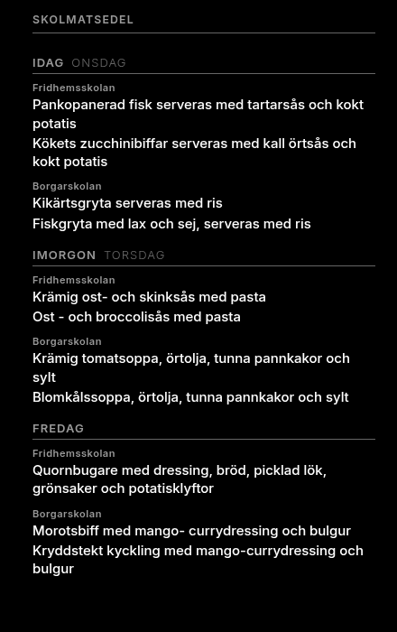

# mirrordash-skolmatsedel

School lunch menus on your mirror, day by day, for one or more schools.



## What it shows

- Under each day, one row per school: the school's name (or a short name you choose, for example a
  child's name), then its dishes, one per line.
- With only one school, the name is left out.
- The day header says "Idag" or "Imorgon" with the weekday dimmed beside it, then only the weekday for
  later days. Weekends are skipped.
- A school with no menu on a day (a holiday, or Skolmaten when next week isn't published yet) is left
  out of that day. A day where no school has a menu isn't shown. When nothing is left, the card hides.
- The text on the mirror is Swedish or English, following the mirror's language.

## Installation

On the mirror's admin page, open **Modules**: the module is in the list, install it with one click.
Or paste `git+https://github.com/Menturan/mirrordash-skolmatsedel.git` under **Modules → Add modules →
Install from a Git URL or folder**.

## Settings

No API key is needed. In the module's settings:

| Setting | What it does |
| :--- | :--- |
| **Schools** | One row per school: **Provider** (Skolmaten or Mateo), then **Municipality**, then **School** (each list follows the one before it), and an optional **Short name** shown instead of the school's name. If the school isn't in one provider, try the other. |
| **Days to show** | How many school days to show, counted from the first day shown. Days without a menu are left out. **Skolmaten publishes only the current week**, so with Skolmaten you see at most the days left of this week; Mateo publishes further ahead. |
| **After lunch** | What happens to today's menu once lunch is over. *After lunch, start from the next school day* (the default; on a Friday that is Monday), *Today stays all day*, or *After lunch, today is dimmed*. |
| **Lunch is over at** | When lunch counts as over, 13:00 unless you change it. |

## Data sources

Both are open and need no key. The module fetches through the mirror's own fetch helper, which keeps
every answer on disk. Each school's menu is fetched **once per calendar day**: on the first redraw after
midnight (not 24 hours after the last fetch), and at once when there is nothing saved yet, or when
you pick another school. The card is redrawn every five minutes for the lunch switch, without fetching.
If a fetch fails, the last good menu stays on the screen and the fetch is retried every 15 minutes at
the earliest. A saved answer from today survives a restart of the mirror.

- **Skolmaten** (skolmaten.se): the only address called is the open RSS feed of one school,
  `https://skolmaten.se/api/4/rss/week/<school>`. It holds **the current week only**; the feed takes no
  date range. The lists of municipalities and schools are **not** fetched while the mirror runs: they are
  bundled with the module (`mirrordash_skolmatsedel/data/schools.json`). Municipalities without schools
  are hidden, and Skolmaten's own test school is left out.
- **Mateo** (`meny-api.mateo.se`): an open JSON API. The module reads `/organizations` (municipalities),
  `/organizations/<municipality>` (its schools and preschools) and `/days/<school>?from=&to=` (the menu
  for the days shown). Only the lunch dishes are shown (types starting with "Lunch", so vegetarian and
  alternative lunches, but not "Tillbehör lunch"), and a dish listed twice is shown once.

The providers live in `mirrordash_skolmatsedel/providers/`, one small file each with the same three
functions, so adding another provider is one more file there.

## Refreshing the school list (only when you choose to)

Skolmaten's municipalities and schools are a list bundled with the module. Schools change rarely, mostly
when the autumn term starts. Rebuilding the list **crawls skolmaten.se and takes about 13 minutes**, so it
is a step of its own that you run **only when you choose to, for example at the start of the autumn
term**. Nothing runs it automatically, and a release does not need it.

It needs `google-chrome` (the site is a JavaScript app, so each page is rendered headless):

```bash
python scripts/build_school_list.py        # asks before it starts; add --yes to skip the question
git diff --stat                            # look at what changed
uv run pytest                              # the tests still pass on the new list
git add mirrordash_skolmatsedel/data/schools.json
git commit -m "Update the school list"
```

If any page fails, the script says so and leaves the old list alone. Then release as usual
(`uvx mirrordash-sdk release X.Y.Z`): the SDK's release needs a clean, committed tree, so refresh and
commit the list *before* releasing. It has no per-module release step of its own.

## Developing

`uv run pytest` runs the tests (no network: the providers are tested on saved real answers in
`tests/fixtures/`), and `uvx mirrordash-sdk validate .` checks the module. The admin page's preview works
offline from made-up sample answers in `mirrordash_skolmatsedel/preview/`.

## License
[MIT](LICENSE)
